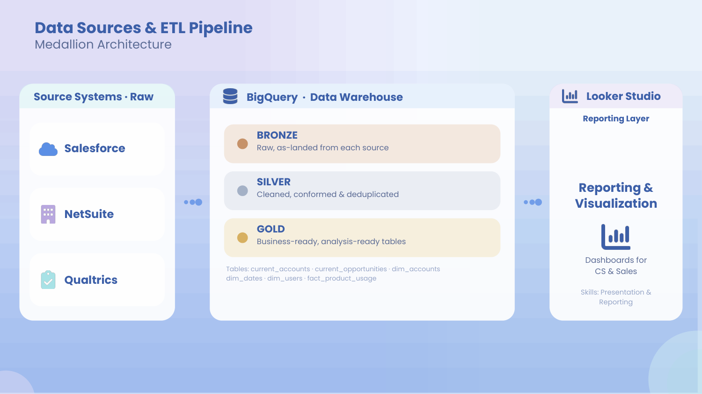
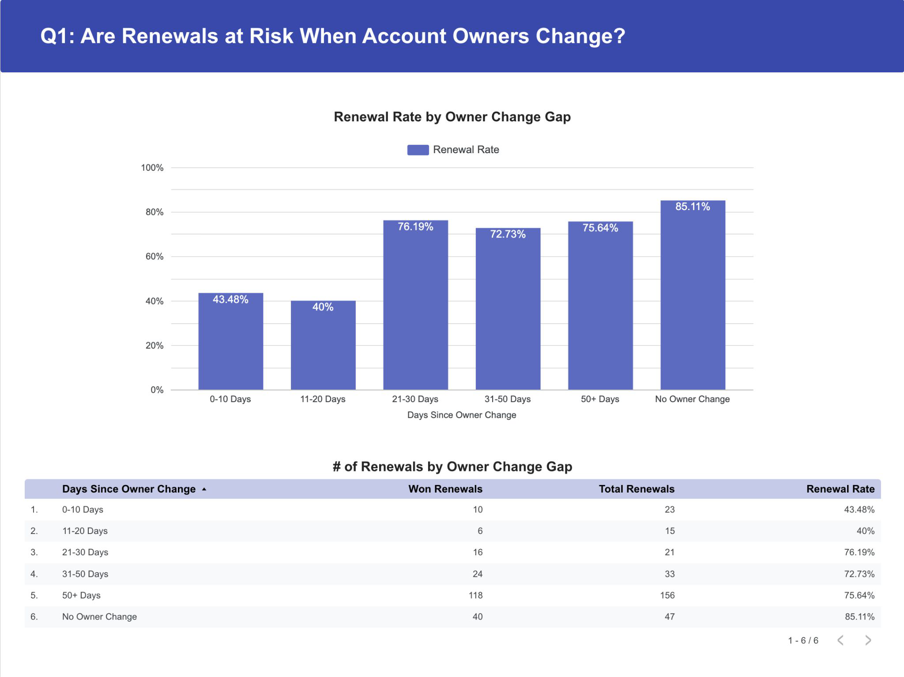
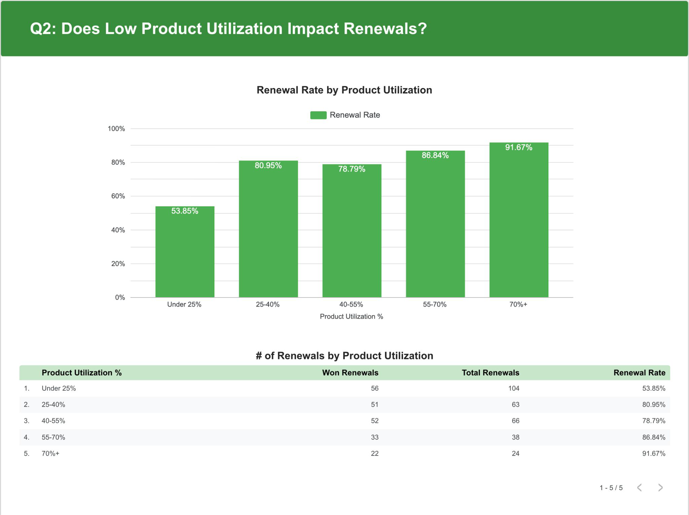
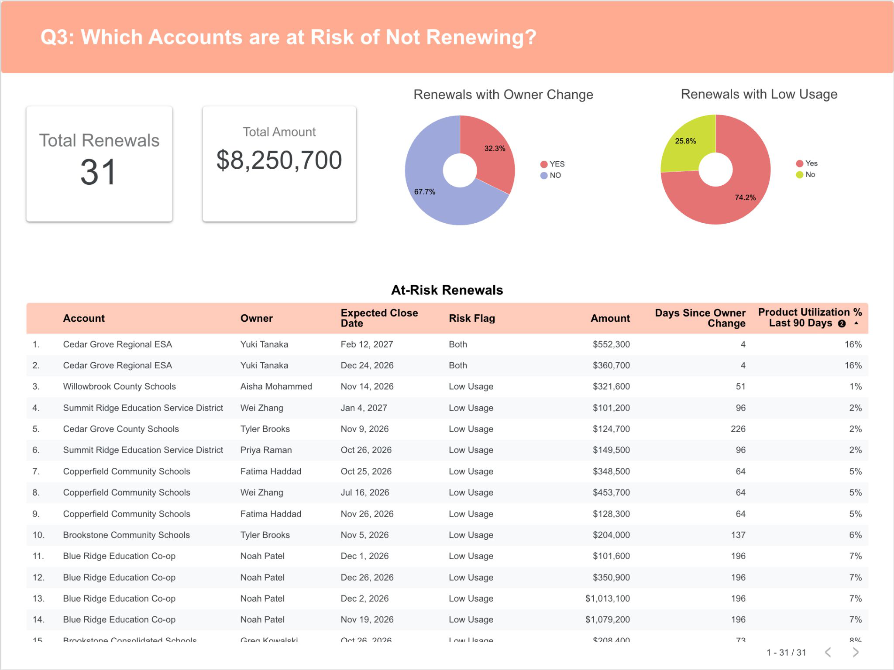

# Northwind Science: Renewal Risk Analysis

This project analyzes renewal risk for Northwind Science, a fictional company that sells science labs to school districts, using synthetic CRM and product usage data. Raw data is loaded into BigQuery, transformed and analyzed with SQL, and the findings are visualized in a Looker Studio dashboard that shows which accounts are most at risk of not renewing.

**Business questions**

1. Are renewals at risk when account owners change?
2. Does low product utilization impact renewals?
3. Which accounts are currently at risk of not renewing?

## Key Findings

- Renewal rates are most impacted when an account owner changes within 20 days of the renewal close date.
- Renewal rate falls from 76.19% (owner change 21-30 days before close) to 40% (owner change 11-20 days before close).
- Accounts with no owner change have the highest renewal rate at 85.11%.
- Accounts with a product utilization score under 25% have the lowest renewal rate (53.85%). Accounts at 70% or higher have the highest (91.67%).
- 31 open renewals worth $8.2M are at risk. 74.2% show low product usage, 32.3% had a recent owner change, and 2 renewals have both flags.

## Architecture

Data follows a medallion pattern in BigQuery, with Looker Studio as the reporting layer.

Gold tables used: `current_accounts`, `current_opportunities`, `dim_accounts`, `dim_dates`, `dim_users`, `fact_product_usage`. Ownership history lives in `dim_accounts` as a Type 2 slowly changing dimension, which is what makes it possible to date each handoff.

## Q1: Are Renewals at Risk When Account Owners Change?

SQL: *[q1_owner_change_win_rate.sql](q1_owner_change_win_rate.sql)*. A `LAG()` window function over each account's ownership history finds every handoff. Each closed renewal is then matched to the most recent handoff before its close date and bucketed by the gap in days.

| Days since owner change | Won | Total | Renewal rate |
|---|---|---|---|
| 0-10 | 10 | 23 | 43.48% |
| 11-20 | 6 | 15 | 40% |
| 21-30 | 16 | 21 | 76.19% |
| 31-50 | 24 | 33 | 72.73% |
| 50+ | 118 | 156 | 75.64% |
| No owner change | 40 | 47 | 85.11% |

**Takeaway:** Account owner changes in the 20 days before a close date impacts renewals the most. Past 20 days, renewal rates recover to 72-76%.

## Q2: Does Low Product Utilization Impact Renewals?

SQL: *[q2_usage_win_rate.sql](q2_usage_win_rate.sql)*. Utilization is active users divided by licensed seats, averaged over the 3 months before the renewal close month. The close month itself is excluded so last-minute logins don't inflate the score.

| Utilization | Won | Total | Renewal rate |
|---|---|---|---|
| Under 25% | 56 | 104 | 53.85% |
| 25-40% | 51 | 63 | 80.95% |
| 40-55% | 52 | 66 | 78.79% |
| 55-70% | 33 | 38 | 86.84% |
| 70%+ | 22 | 24 | 91.67% |

**Takeaway:** For accounts with a product utilization score under 25%, roughly half of the renewals are lost. From 25% to 70% rates are relatively consistent (79-87%), and 70%+ is highest.

## Q3: Which Accounts Are At Risk of Not Renewing?

SQL: *[q3_at_risk_renewals.sql](q3_at_risk_renewals.sql)*. Applies both signals (low product utilization scores and account owner changes) to every open renewal, then sorts accounts with both flags first and low product usage next, so the Senior Director of RevOps and the CS team get a priority queue.

- 31 at-risk renewals worth $8.2M
- 74.2% have low product usage
- 32.3% had an owner change in the last 30 days
- 2 renewals (Cedar Grove Regional ESA, $913,000 combined) have both flags and are the highest priority

## Recommendations

1. Minimize account owner changes within 20 days of a renewal close date.
2. Flag accounts under 25% utilization and offer additional support: check-ins, training, a review of plan subscription and features.
3. Have the CS team prioritize upcoming renewals that carry both risk flags.

## Next Steps

- Rebuild as a reusable dbt model so the logic is version-controlled and accessible to the team.
- Pull the list of specific accounts with owner changes, not only the bucketed view.
- Check in after 3 months to see whether renewal rates and revenue improved after the recommendations.

## Repository Contents

| File | Description |
|---|---|
| `q1_owner_change_win_rate.sql` | Win rate by days between owner change and close |
| `q2_usage_win_rate.sql` | Win rate by 90-day product utilization |
| `q3_at_risk_renewals.sql` | Open renewals flagged for low usage or recent owner change |
| `dim_accounts.csv`, `dim_opportunities.csv`, `dim_users.csv`, `dim_date.csv`, `fact_product_usage.csv` | Synthetic source tables |
| `Northwind Renewal Project Slides.pdf` | Presentation deck |
| `images/` | Dashboard screenshots and architecture diagram |

## Tools & Skills

**Tools:** BigQuery, SQL, Looker Studio

**Skills:** SQL analysis (CTEs, window functions, date arithmetic), data modeling (SCD Type 2), ETL/data pipeline design, dashboard design, business reporting and presentation

*All data is synthetic. Northwind Science is a fictional company.*
